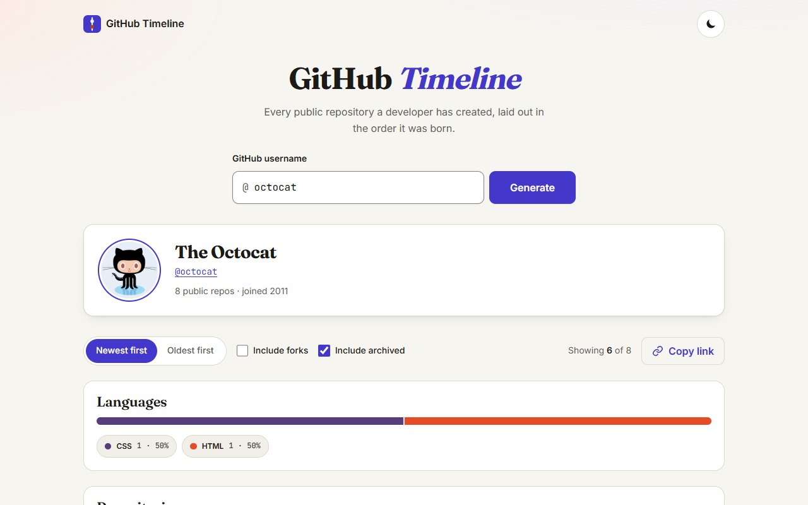

# GitHub Timeline

Turn any GitHub user's public repositories into a polished, shareable chronological timeline.

🌐 **Live Demo on Render**: [https://github-timeline-txo5.onrender.com](https://github-timeline-txo5.onrender.com)



> 🎬 **Recorded Demo Video**: [Watch `docs/demo.mp4`](./docs/demo.mp4)

## Features

- **Chronological repository history**: Enter any GitHub username to generate a vertical timeline of their public repositories, complete with creation dates, descriptions, primary language chips, star counts, fork/archive badges, and external homepage links.
- **Full pagination**: Automatically paginates through the GitHub REST API (`per_page=100`) until all public repositories are loaded—supporting prolific accounts with hundreds or thousands of repositories.
- **Interactive filtering & sorting**: Instantly toggle between **Newest first** and **Oldest first**, and filter forks or archived repositories without refetching.
- **Language breakdown & click-to-filter**: A multi-segment proportional bar and interactive language chips powered by GitHub Linguist colors. Click any language chip (in the breakdown bar or on a repository card) to filter the timeline and year summary to that language.
- **Repositories-per-year summary**: A responsive CSS bar chart summarizing annual output that updates with active filters. Clicking any year smooth-scrolls and moves focus to that year's marker on the timeline, paired with an accessible data table for screen readers and print.
- **Shareable deep links**: Syncs the active username to `?user={username}` via `history.replaceState`, updates the document title and meta description, and provides a one-click **Copy link** button with clipboard fallback.
- **Light, dark, and print themes**: Automatically follows `prefers-color-scheme` with a persistent manual override in `localStorage`, plus a dedicated `@media print` stylesheet for saving clean PDFs.
- **Resilient & accessible**: Client-side username validation, `AbortController` race-condition protection, 10-minute in-memory + `sessionStorage` caching, WCAG 2.1 AA contrast, semantic landmarks, polite `aria-live` status updates, and `prefers-reduced-motion` support.

## Tech Stack

- **Frontend**: React 18 + TypeScript (strict mode) + Vite 5
- **Backend**: Node.js + Express + TypeScript (`server/app.ts`, `server/githubProxy.ts`)
- **Database**: Dual-mode **SQLite** (`node:sqlite` locally, zero setup) + **PostgreSQL** (`pg` in production when `DATABASE_URL` is configured) (`server/db.ts`)
- **Styling**: Plain CSS with CSS custom properties (`tokens.css`, `base.css`, `components.css`, `timeline.css`, `print.css`)
- **Data source**: Backend database cache & GitHub REST API v3 proxy (`/api/timeline/:username`) with optional `GITHUB_TOKEN` support (5,000 req/hr) and automatic client-side fallback
- **Testing**: Vitest + React Testing Library + Supertest + `@vitest/coverage-v8`
- **Code quality**: ESLint 9 (strict TypeScript config, zero warnings) + Prettier

## Setup & Run Instructions

### Prerequisites

- Node.js 22.5+ (includes built-in `node:sqlite`) and npm 10+

### Install & run

```bash
# Install dependencies
npm install

# Start the backend API + SQLite database server (http://localhost:3001)
npm run dev:server

# Start the Vite frontend dev server (proxies /api to :3001)
npm run dev

# Type-check and build the frontend for production
npm run build

# Start the full-stack production server (serves API + built frontend)
npm start

# Run the full test suite (frontend, API, and backend + SQLite database tests)
npm test

# Run tests with coverage
npm run coverage

# Run ESLint (zero warnings allowed)
npm run lint
```

### Environment Variables (Optional Locally)

- `PORT`: Backend server port (defaults to `3001`).
- `DATABASE_URL`: PostgreSQL connection string (when omitted, the server automatically uses a local SQLite database at `./data/timeline.sqlite`).
- `GITHUB_TOKEN`: Optional GitHub Personal Access Token on the backend to raise the GitHub API rate limit from 60 to 5,000 requests/hour.

## Design Decisions & Trade-offs

1. **Pure-function username validation (no lookbehind regex)**: GitHub usernames allow 1–39 ASCII alphanumerics or single hyphens, and cannot start or end with a hyphen. Validation is implemented as a character loop in `src/utils/validateUsername.ts` rather than a regex with lookbehinds so older Safari engines never fail to parse the bundle.
2. **UTC date formatting and grouping**: Both `formatDate` and `getYear` format timestamps in UTC. This guarantees that a repository created near midnight UTC never displays a December 31 date inside a January 1 year group (or vice versa) depending on the viewer's local timezone.
3. **Two-tier caching (`Map` + `sessionStorage`)**: Lookups are cached in memory and mirrored to `sessionStorage` with a 10-minute TTL (`src/api/cache.ts`). Every entry read back from `sessionStorage` is re-validated through `parseUser` and `parseRepo` so corrupted or manually edited storage can never break rendering.
4. **Incremental rendering + `content-visibility: auto`**: Timelines render in batches of 60 cards with a **Show more** button, and lists exceeding 100 items enable `content-visibility: auto` to keep layout and paint costs low. Selecting a year in the summary bar chart automatically expands the visible slice to include that year before scrolling.
5. **Build-time Content Security Policy**: Vite's development server injects inline preamble scripts for React Fast Refresh, which a strict `script-src 'self'` blocks. A tiny Vite plugin in `vite.config.ts` injects the restrictive `<meta http-equiv="Content-Security-Policy">` tag during `vite build` so production builds remain locked down while `npm run dev` works seamlessly.
6. **Automatic contrast for language chips**: GitHub Linguist colors range from pale yellow (`#f1e05a` for JavaScript) to deep navy (`#000080` for Lua). `getReadableTextColor` computes WCAG relative luminance for each chip's background color and picks near-black (`#111111`) or white (`#ffffff`) to guarantee readable text.

## Known Limitations

- **Unauthenticated GitHub API rate limit (60 requests/hour)**: Because the app runs entirely in the browser with no backend or token, GitHub limits requests to 60 per hour per IP address. Calling `GET /users/{username}` plus `N` pages of `GET /users/{username}/repos` consumes `1 + N` requests on a cache miss. When the limit is reached, the UI displays the exact local reset time from the `x-ratelimit-reset` header.
- **Static Open Graph tags**: Social crawlers do not execute client-side JavaScript when scraping shared `?user=...` URLs, so `index.html` ships static Open Graph defaults while `document.title` and `<meta name="description">` update dynamically in the browser.
- **Up to 10,000 repositories per user**: `fetchAllRepos` caps pagination at 100 pages (`10,000` repositories) as a safeguard against infinite loops if an upstream proxy ever returns malformed pagination headers.

## Deployment

The production build outputs static files to `dist/` with a relative base path (`./`), making it deployable to any static host.

### GitHub Pages

1. Run `npm run build`.
2. Push the `dist/` folder to your `gh-pages` branch (or use `actions/deploy-pages` in GitHub Actions with `path: dist`).

### Netlify

1. Connect the repository in Netlify.
2. Set **Build command** to `npm run build` and **Publish directory** to `dist`.

### Vercel

1. Import the project in Vercel (Vite is auto-detected).
2. Confirm **Build Command** is `npm run build` and **Output Directory** is `dist`, then deploy.

### Render (Full-Stack Web Service + PostgreSQL Database)

This repo includes a [`render.yaml`](./render.yaml) Blueprint that provisions both the **Node.js Web Service** and a **Render PostgreSQL Database**:

1. In the [Render Dashboard](https://dashboard.render.com/), click **New +** → **Blueprint**.
2. Connect your GitHub repository (`mennatallahessam/github-timeline`).
3. Render will create:
   - `github-timeline-db` (managed PostgreSQL database)
   - `github-timeline` (Node.js web service wired to `DATABASE_URL`, with `Build Command: npm ci && npm run build` and `Start Command: npm start`)
4. Optionally provide a `GITHUB_TOKEN` environment variable to unlock 5,000 GitHub API requests/hour.
5. Click **Apply** to deploy the full-stack app and database.
